<!-- console:start -->

<picture><source media="(prefers-color-scheme: dark)" srcset="./assets/header-dark.svg"><source media="(prefers-color-scheme: light)" srcset="./assets/header-light.svg"></picture>
<picture><source media="(prefers-color-scheme: dark)" srcset="./assets/links-dark.svg"><source media="(prefers-color-scheme: light)" srcset="./assets/links-light.svg"></picture>
<!-- links:start -->
<a href="https://github.com/yigal100"><picture><source media="(prefers-color-scheme: dark)" srcset="./assets/links/github-dark.svg"><source media="(prefers-color-scheme: light)" srcset="./assets/links/github-light.svg"></picture></a><a href="https://www.linkedin.com/in/yigal-chripun/"><picture><source media="(prefers-color-scheme: dark)" srcset="./assets/links/linkedin-dark.svg"><source media="(prefers-color-scheme: light)" srcset="./assets/links/linkedin-light.svg"></picture></a>
<!-- links:end -->
<picture><source media="(prefers-color-scheme: dark)" srcset="./assets/stats-dark.svg"><source media="(prefers-color-scheme: light)" srcset="./assets/stats-light.svg"></picture>
<picture><source media="(prefers-color-scheme: dark)" srcset="./assets/phosphor-radar-dark.svg"><source media="(prefers-color-scheme: light)" srcset="./assets/phosphor-radar-light.svg"></picture>
<picture><source media="(prefers-color-scheme: dark)" srcset="./assets/projects-dark.svg"><source media="(prefers-color-scheme: light)" srcset="./assets/projects-light.svg"></picture>
<!-- projects:start -->
<a href="https://github.com/yigal100/second-brain"><picture><source media="(prefers-color-scheme: dark)" srcset="./assets/card-second-brain-dark.svg"><source media="(prefers-color-scheme: light)" srcset="./assets/card-second-brain-light.svg"></picture></a><a href="https://github.com/yigal100/photon"><picture><source media="(prefers-color-scheme: dark)" srcset="./assets/card-photon-dark.svg"><source media="(prefers-color-scheme: light)" srcset="./assets/card-photon-light.svg"></picture></a>
<a href="https://github.com/yigal100/yigal100"><picture><source media="(prefers-color-scheme: dark)" srcset="./assets/card-yigal100-dark.svg"><source media="(prefers-color-scheme: light)" srcset="./assets/card-yigal100-light.svg"></picture></a>
<!-- projects:end -->
<picture><source media="(prefers-color-scheme: dark)" srcset="./assets/stack-dark.svg"><source media="(prefers-color-scheme: light)" srcset="./assets/stack-light.svg"></picture>
<picture><source media="(prefers-color-scheme: dark)" srcset="./assets/reading-dark.svg"><source media="(prefers-color-scheme: light)" srcset="./assets/reading-light.svg"></picture>
<!-- reading:start -->
<a href="https://itnext.io/the-difference-between-the-clever-developer-the-wise-developer-a0edd9d8a692"><picture><source media="(prefers-color-scheme: dark)" srcset="./assets/reading/item-1-dark.svg"><source media="(prefers-color-scheme: light)" srcset="./assets/reading/item-1-light.svg"></picture></a>
<!-- reading:end -->
<picture><source media="(prefers-color-scheme: dark)" srcset="./assets/footer-dark.svg"><source media="(prefers-color-scheme: light)" srcset="./assets/footer-light.svg"></picture>

<!-- console:end -->

Regenerated daily by <code>mise run sync</code> (<a href="https://github.com/yigal100/yigal100">source</a>). Console design and contribution city by <a href="https://github.com/georgekobaidze/georgekobaidze">Giorgi Kobaidze</a> (<a href="https://dev.to/georgekobaidze/i-turned-my-github-profile-into-a-cyberpunk-console-with-a-city-built-from-my-contributions-h4c">how he built it</a>), used under MIT.

