<!-- links:start -->
<!-- links:start -->

<!-- links:end -->
<!-- links:end -->

<!-- projects:start -->
<!-- projects:start -->

<!-- projects:end -->
<!-- projects:end -->

<!-- writing:start -->

<!-- writing:end -->

